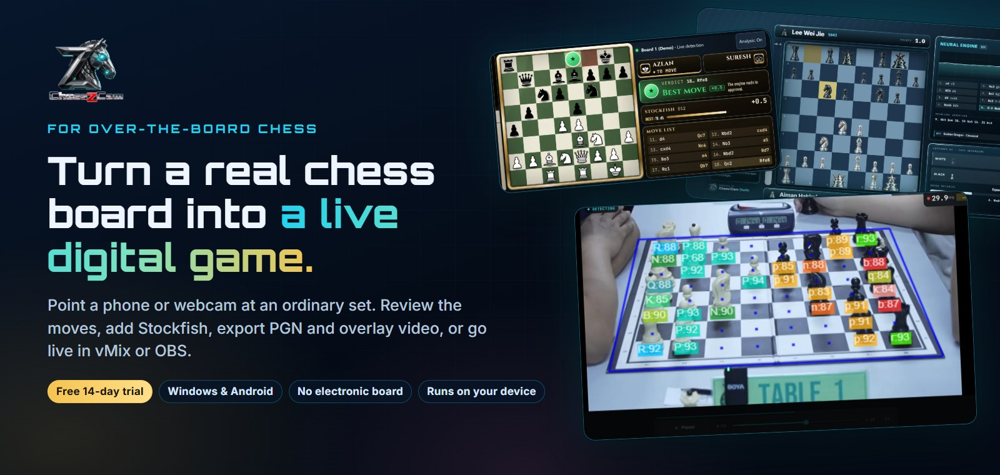
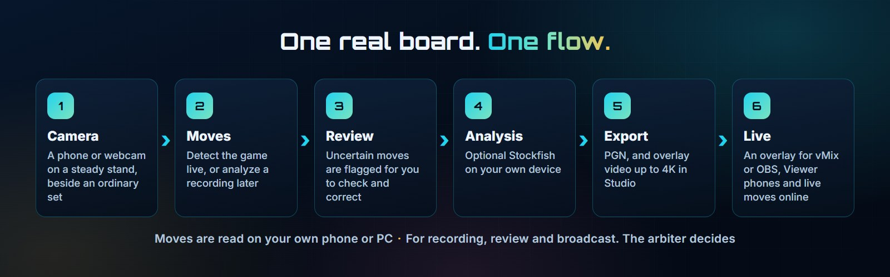
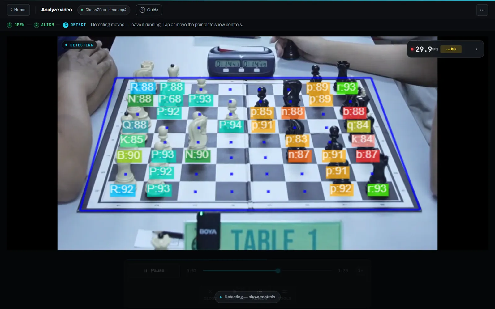
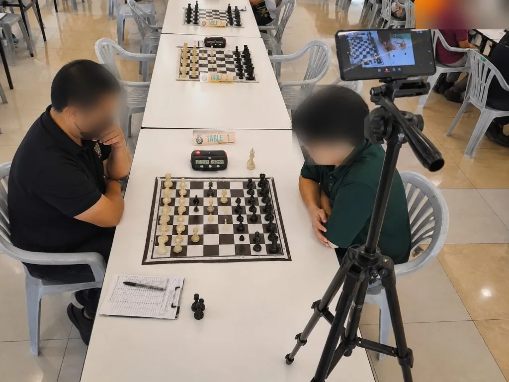
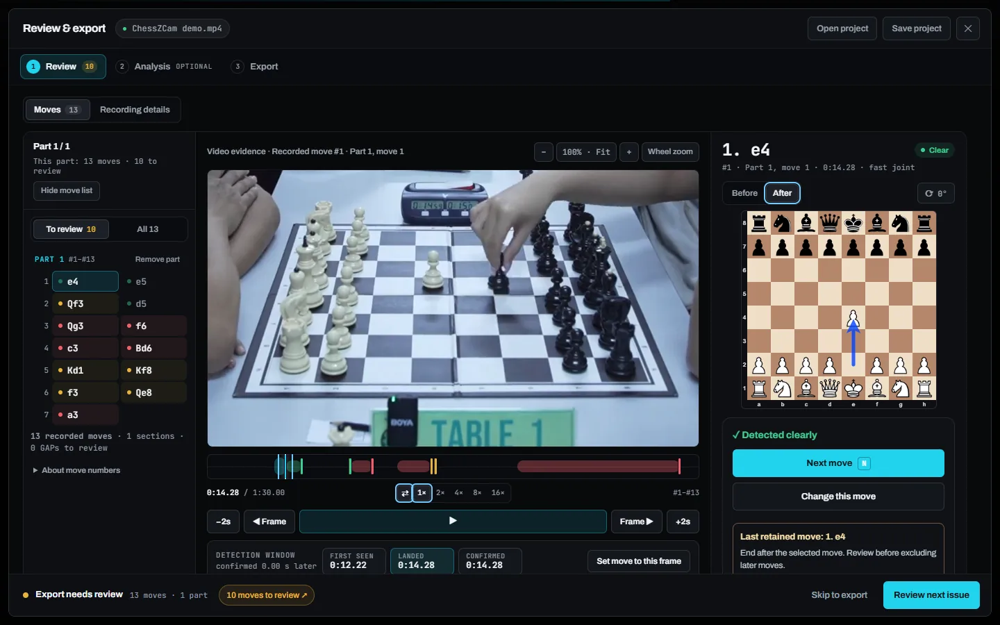
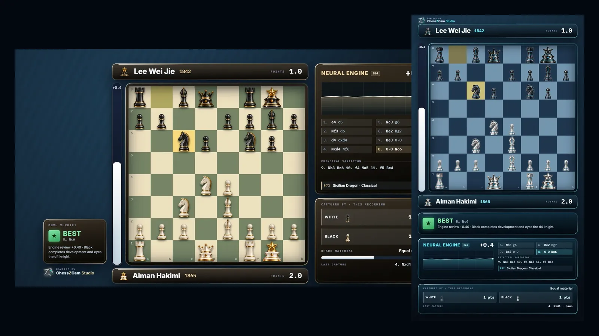
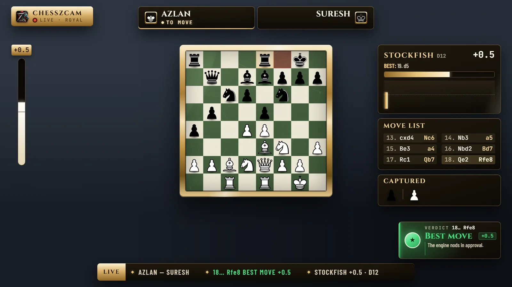
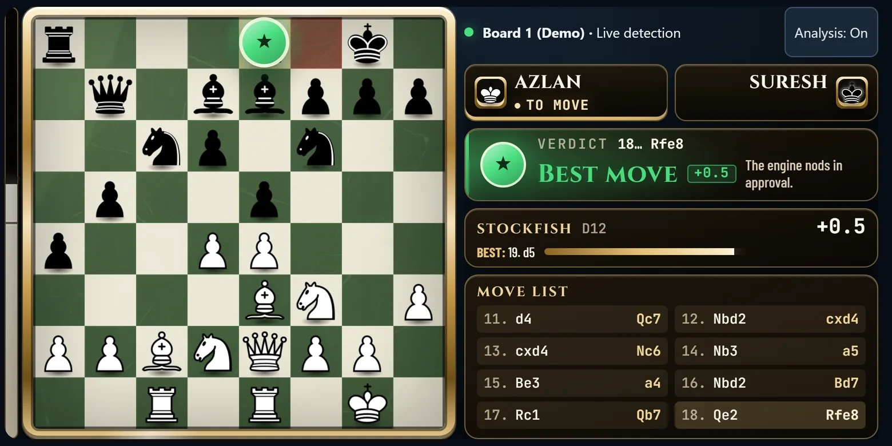

<p align="center">
  
</p>

<h3 align="center">Read the moves of a real chess game from a phone or webcam</h3>

<p align="center">
  <a href="https://zonchess.com/chesszcam-download.html"><b>⬇ Download the free 14-day trial</b></a>
  &nbsp;·&nbsp;
  <a href="#features">See what it does</a>
  &nbsp;·&nbsp;
  <a href="#install">Install</a>
  &nbsp;·&nbsp;
  <a href="https://www.youtube.com/@zonchessZ">Watch real games</a>
  &nbsp;·&nbsp;
  <a href="https://zonchess.com/feedback.html?product=ChessZCam">Send feedback</a>
  &nbsp;·&nbsp;
  <a href="https://zonchess.com/ms/chesszcam-download.html">Bahasa Melayu</a>
</p>

## What is ChessZCam?

**ChessZCam reads the moves of an over-the-board chess game from a phone or webcam pointed at an ordinary set.** Record a game and analyze it later, or let ChessZCam follow the board live. In a recorded game, every move is kept with its moment in the video, so you can check it, correct it and export it as PGN or as an overlay video. A live game goes straight to PGN, with no video saved, and you can also send the live board to vMix or OBS. No electronic board is needed.

**ChessZCam is for recording, review and broadcast. It is not an adjudication device.** It must never be used to settle a dispute at the board. That is the arbiter's job.

It was built in Malaysia by an independent chess parent, shaped by six tournament tests so far, and it is in public beta now.

## The trial at a glance

| | |
|---|---|
| **Price** | Free for 14 days, with no code, payment or account |
| **Start** | You choose when the 14 days begin. Internet is needed for that moment only |
| **Limit** | One trial per PC in ChessZCam Studio, and one per phone in the Android app |
| **Live** | The Studio trial includes ChessZCam Live, so Studio can be the camera for your vMix or OBS overlay |
| **System** | Windows 10 or 11 (64-bit), or Android 7 or newer (Android 10 or newer to record video and export MP4) |
| **Languages** | English, Bahasa Melayu and 中文 |
| **Your data** | Moves are read on your own phone or PC. Recordings, PGN files and projects are saved on your device. Game data leaves it only through a sharing feature you turn on |

<p align="center">
  
</p>

## Problems it solves

| At the board | How ChessZCam helps |
|---|---|
| You want a game on record, but the board is not electronic | A phone or webcam beside an ordinary set reads the moves |
| Turning a game video into PGN means entering every move by hand | Analyze Video reads the recording, so you check moves instead of typing them |
| A camera can miss a move, and you do not want a guess in your record | Uncertain moves are flagged for review, and a recorded game shows the video frame beside every move |
| A move was missed, or the camera was nudged | Add the move by clicking or dragging, repair the gap, and keep the moves that were already right |
| A coach or parent wants to see where a game turned | Optional Stockfish analysis on your device, with move grades, accuracy per player and opening names |
| Game footage is hard for viewers to follow | Overlay video adds the digital board, eval bar, verdicts and player names, in landscape or portrait |
| A stream needs a live board without typing each move | The board position goes to ChessZCam Live, which drives an overlay in vMix or OBS |
| Parents and coaches must stay outside the playing hall | Viewer Mode shows the live board on their own Android phone, on the same Wi-Fi or hotspot |
| An organizer wants a featured board online while it is played | Live PGN (beta) sends confirmed moves to zonChess Live, a Lichess Broadcast or a website with a compatible PGN receiver |

## See it on real games

The [zonChess YouTube channel](https://www.youtube.com/@zonchessZ) has real tournament games processed with ChessZCam, from early versions to the latest. The footage comes from different cameras, angles and lenses, so you can judge for yourself what ChessZCam reads well and where it still falls short. Older videos show older versions. If you spot a wrong move, please tell us.

## Features

- [Analyze a recorded game](#1-analyze-a-recorded-game)
- [Detect or record a live game](#2-detect-or-record-a-live-game)
- [Review and correct](#3-review-and-correct)
- [Stockfish analysis](#4-stockfish-analysis)
- [Export PGN and overlay video](#5-export-pgn-and-overlay-video)
- [Live overlay for vMix or OBS](#6-live-overlay-for-vmix-or-obs)
- [Publish live moves (beta)](#7-publish-live-moves-beta)
- [Viewer Mode](#8-viewer-mode)

### 1. Analyze a recorded game



- **Open a recording:** MP4 or WebM. Studio also opens MTS, M2TS and TS camera files without converting them first.
- **Lock the board:** ChessZCam finds the corners, you lock the board and press Play & Detect.
- **Adaptive scan:** 1× to 4× speed, slowing down by itself when needed.
- **Every move is stored** with its timestamp and video frame.
- **Long recordings** can be analyzed part by part.

### 2. Detect or record a live game

<p align="center">
  
</p>

- **Detect Live:** the camera goes straight to PGN while the game is played. No video is saved, so it uses little storage.
- **Record Game Video:** save the whole game with audio and analyze it later, with a framing guide and optional game details.
- **Cameras in Studio:** a webcam, a capture card or OBS Virtual Camera.
- **On the phone:** lock focus and exposure when the light keeps changing.
- **If the board is nudged:** a small shift is corrected by itself. After a larger one, detection pauses so you can realign.

### 3. Review and correct



- **Evidence beside every move:** in a recorded game, the exact video frame and the board after the move, with first-seen, landed and confirmed times.
- **Flagged, not guessed:** uncertain moves are marked for review instead of being filled in quietly.
- **Add or repair moves:** click or drag to add a missed move, castling and promotion included. Repair several missed moves, then rescan once.
- **Fill a gap** straight from the video.
- **Recover tracking:** ChessZCam suggests the move that connects two parts, so parts split by unclear video can be joined in one click.
- **End the game** at the last real move.
- **Projects:** save a review and continue later, with its corrections, analysis and layout.

### 4. Stockfish analysis


- **On your own device:** optional offline analysis at Balanced or Deep depth.
- **Move grades** from Book move to Blunder, with accuracy per player.
- **Opening names** from an offline book.
- **Plain-language comments** in English, Bahasa Melayu or 中文.

### 5. Export PGN and overlay video



- **PGN:** save, copy or share the moves.
- **Lay out the overlay:** drag and resize each panel over your footage, then choose where the video ends.
- **MP4 video:** the overlay burned in, with audio. Your original video stays unchanged.
- **Sizes:** 1920×1080 or 1080×1920 on the phone and in Studio, and 3840×2160 in Studio.
- **For video editors:** transparent WebM or a PNG sequence, in Studio.
- **Looks:** finishes such as Neon Circuit, Champagne Royale and Amethyst Atelier bring their own board and pieces.
- **Sync PGN to Video (Android):** match a PGN you already have to a recording and export a timed overlay.

### 6. Live overlay for vMix or OBS



- **How it works:** the board position, not a video stream, goes over your local network to ChessZCam Live. ChessZCam Live serves the overlay as a browser URL, and you put it above your camera as a browser input in vMix or a Browser Source in OBS.
- **The detector:** a phone, or ChessZCam Studio on the same PC with a webcam or capture card.
- **Pairing:** the phone scans a pairing QR code, and Studio pairs in one click. Only a paired device can send moves, one detector at a time, even on a shared hall network.
- **Operator control:** a status strip for hub, phone, detector and overlay, and a correction screen that checks a position before detection can resume.
- **Hold and resume:** hold the overlay for a replay or a correction, then resume from the position you approve. The overlay's move list starts again from there, so keep the phone's PGN as the game record.
- **Built for a hall:** every move is acknowledged by the PC, and after a Wi-Fi drop the overlay catches up in one clean resync. The broadcast state is kept for up to 12 hours.
- **Overlay Designer:** six styles and 10 modules, with lower-third cards for players, event, round and venue in every style except Classic. Style and layout changes stay a draft until you press **PUSH TO OVERLAY**.
- **Verdict lane:** a short plain-language note per move, in English, Bahasa Melayu or 中文.

### 7. Publish live moves (beta)

- **While the game is played:** during Detect Live, the moves the camera confirms go to [zonChess Live](https://zonchess.com/live/), a Lichess Broadcast or a website with a compatible PGN receiver.
- **Set up by the organizer:** for zonChess Live, paste the board link and token, or scan the board QR code. For a Lichess Broadcast, paste the round link and an access token. For a website, paste the URL of an HTTPS endpoint that accepts raw PGN by POST and allows ChessZCam through CORS. A normal viewer page will not work.
- **No video:** Live PGN sends the moves and game details (players, event, round, board and result) over the internet. Video and engine analysis are not sent.
- **A clear indicator:** LIVE PGN over the video shows whether moves are being sent.
- **Where:** ChessZCam Studio and the Android app.

### 8. Viewer Mode



Viewer Mode lets a parent or coach outside the playing hall follow the live digital board on their own phone.

- **Same Wi-Fi or hotspot only:** viewers join the same network as the host. It does not work from home or over mobile data.
- **Android only:** each viewer needs the ChessZCam Android app. It does not work on an iPhone or in a web browser.
- **Read-only:** viewers cannot change the board, the camera or the broadcast.
- **What viewers see:** player names, a verdict for each move, Stockfish and the move list, with an Analysis Off switch on each viewer's own phone.
- **Who hosts:** the camera phone, or a PC running Studio or ChessZCam Live. Two phones are enough.
- **One board per link,** with the viewer's phone held sideways and the app kept open.
- **Same release:** the host and every viewer phone must be on the same ChessZCam release. A device on another release is told to update.
- **Free:** Viewer stays free, with no spectator licence limit. Capacity depends on your network and devices.

**Fair play.** Viewer Mode shows engine analysis. It is for spectators outside the playing hall, never for players, and it is not an arbiter's record. Whether it may be used at an event is the organizer's decision.

## Supported formats

| | |
|---|---|
| **Video to analyze** | MP4 or WebM. Studio also opens MTS, M2TS and TS camera files with progressive H.264 video |
| **Live cameras** | The Android phone's camera. In Studio: a webcam, a capture card or OBS Virtual Camera |
| **Moves** | PGN |
| **Overlay video** | MP4 with the overlay and audio, at 1920×1080 or 1080×1920, plus 3840×2160 in Studio |
| **For video editors** | Transparent WebM or a PNG sequence, in Studio |
| **Projects** | A ChessZCam project file (`.review-project.json`) that holds a review |
| **Live overlay** | A browser URL, used as a browser input in vMix or a Browser Source in OBS |
| **Live moves (beta)** | zonChess Live, a Lichess Broadcast or an HTTPS PGN receiver |
| **Chess** | Standard chess on an ordinary board and set, with one camera for one board |

## Install

### Which app do I need?

| App | Runs on | Use it to | Latest release |
|---|---|---|---|
| **ChessZCam Studio** | Windows 10 or 11, 64-bit | Analyze video, record from a webcam or capture card, use Detect Live and Live PGN, review, analyze and export, host Viewer, and be the camera for ChessZCam Live | [Studio 1.2.8](https://github.com/mfamirs/chesszcam-downloads/releases/tag/studio-v1.2.8) |
| **ChessZCam for Android** | Android 7 or newer (recording and MP4 export need Android 10), with the phone held sideways | Record, analyze, use Detect Live and Live PGN, broadcast to the PC, use Viewer, and sync a PGN to a video | [Android 1.27.8](https://github.com/mfamirs/chesszcam-downloads/releases/tag/android-v1.27.8) |
| **ChessZCam Live vMix** | Windows 10 or 11, 64-bit, on the same PC as vMix or OBS | Run the operator console and the on-air overlay for vMix or OBS, fed by the phone app or Studio | [Live 1.14.3](https://github.com/mfamirs/chesszcam-downloads/releases/tag/live-vmix-v1.14.3) |

The [download page](https://zonchess.com/chesszcam-download.html) always shows the newest version of all three.

### Check your download (optional)

Every release lists the SHA-256 of each file. On Windows, open PowerShell in the folder with the file and run this, using the name of your file:

```powershell
Get-FileHash .\ChessZCam-Studio-1.2.8-Setup.exe -Algorithm SHA256
```

### ChessZCam Studio

1. **Download** the installer (`Setup.exe`) or the portable version. The portable version needs no installation: keep it in a folder of your choice.
2. **Run it.** Windows may show "Windows protected your PC" because Studio is new and not yet widely downloaded. Choose **More info**, then **Run anyway**. Only do this for a file from this page.
3. **Start the trial.** Tick the terms box and choose **Agree & start my 14-day trial**. Internet is needed for that moment only.
4. **Try the demo.** A guided tour and a bundled demo clip show Analyze Video from start to finish.

### ChessZCam for Android

1. **Download the APK** on your phone. The app is not on Google Play yet.
2. **Allow installs from your browser** when Android asks, then open the APK. If you installed a test build signed with a different key before, uninstall that one first.
3. **Start the trial** with **Agree & start my 14-day trial**, then use the phone sideways. The app does not run in portrait.

### ChessZCam Live for vMix or OBS

1. **Install it on the same Windows PC as vMix or OBS.** Run vMix or OBS there too, because the console and overlay can only be reached from that PC. If Windows warns you, choose **More info**, then **Run anyway**, and allow network access when asked.
2. **Connect the detector.** On the phone, open Broadcast and scan the pairing QR shown in ChessZCam Live. In Studio on the same PC, pair in one click.
3. **Add the overlay.** Put the overlay URL above your camera as a browser input in vMix or a Browser Source in OBS.
4. **Use a network you control.** Many halls isolate guest devices on their Wi-Fi. A dedicated router or a phone hotspot is the reliable choice.
5. **Rehearse before a public event,** and keep the phone and the PC on the same release.

The apps tell you when a newer version is published. On Android, download the new APK, open it and choose Update. Your games, settings and trial stay on the phone.

### Help the camera see clearly

- **Keep the view stable:** use a firm stand at the side of the board, then lock the board and keep the phone and board still.
- **Show the whole board:** all 64 squares and all four corners, with room for the tallest piece on the far square. Use 0.5× wide zoom if your phone has it.
- **Use even light:** avoid glare on the board and deep shadows.
- **Use an ordinary tournament set** with clear contrast between squares and pieces.
- **Keep captured pieces outside the board.** Pieces against the edge can be mistaken for pieces in play.
- **Review before you publish:** check flagged moves, promotions and gaps.

The [recording guide](https://zonchess.com/chess-recording-guide.html) shows each rule in a picture, and the [setup guide](https://zonchess.com/setup-guide.html) walks through a first event.

## Good to know

- **Public beta.** ChessZCam is still in stability testing, and we improve it with every release. Keep your own copy of important recordings and PGN, and please tell us when something does not work the way you expect.
- **Best-effort detection.** Accuracy depends on your setup and the quality of the video. See the [known limitations](https://zonchess.com/beta-known-limitations.html).
- **One camera, one board.** ChessZCam is built for featured boards and recorded games. It does not read chess clocks.
- **Live needs an operator.** ChessZCam Live runs one camera phone and one board per PC.
- **Local network.** The link between phone and PC is ordinary local-network traffic. It is not encrypted.
- **Timing.** On the digital board, pieces sometimes move slightly out of step with the video. We are still refining this.
- **Privacy.** No account is needed. Starting a trial sends only what the [privacy policy](https://zonchess.com/privacy.html#chesszcam-activation) lists.
- **After the trial.** You can still open, save, correct and export your existing projects, saved analysis stays readable, and Viewer stays free. New recordings, new scans, live detection, engine analysis, board hosting and Live need a licence.
- **Support.** ChessZCam is built by one independent developer. Support is personal, not a service contract.

## Common questions

### How do I record a chess game without an electronic board?

Put a phone or webcam on a steady stand beside an ordinary set, with all four corners in view. Use Detect Live to go straight to PGN, or record the game and use Analyze Video later. Check any flagged moves, then export.

### How do I turn a chess video into PGN?

Open the MP4 or WebM in Analyze Video, lock the board and press Play & Detect. ChessZCam reads the moves and flags the ones it is unsure of. Review those moves, then export the PGN.

### How do I add a live chess board overlay to vMix or OBS?

Run ChessZCam Live on the same Windows PC as vMix or OBS. Pair the phone app or Studio with it, then add its overlay URL as a browser input in vMix or a Browser Source in OBS. The phone sends the moves, and your broadcast camera provides the picture.

### How accurate is ChessZCam?

It depends on your setup and the quality of the video. No camera system reads every move perfectly, so plan for a quick review. Uncertain moves are flagged instead of guessed. A steady stand, the whole board in view and even light make the biggest difference. You can judge it yourself on the [zonChess YouTube channel](https://www.youtube.com/@zonchessZ).

### Can an arbiter use ChessZCam to settle a dispute?

No. ChessZCam is not an adjudication device. It is for recording, review and broadcast, and any dispute at the board belongs to the arbiter.

### Can parents follow a game from home?

No. Viewer Mode works on the same Wi-Fi or hotspot as the host, in the ChessZCam Android app, and it is read-only. It suits parents and coaches who are at the venue but outside the playing hall.

### Can ChessZCam publish moves to Lichess?

Yes, in beta. During Detect Live, Live PGN sends the moves the camera confirms to a Lichess Broadcast or to zonChess Live. For Lichess, the organizer gives you a round link and an access token. For zonChess Live, each board has a link and token, or a board QR code.

### Do I need a PC?

Not for everything. One Android phone can record, detect, review, analyze and export. A Windows PC adds ChessZCam Studio for a bigger screen, more speed and 4K video, or ChessZCam Live for broadcasting into vMix or OBS.

### Can ChessZCam follow every board in a hall?

No. A broadcast follows one active source at a time, so one board per phone and console. ChessZCam does not replace a hall full of electronic boards.

### Does ChessZCam work on iPhone or Mac?

Not at the moment. The phone app is for Android, and the PC apps are for Windows 10 and 11.

### Does ChessZCam need the internet?

Only once, to start the trial or activate a licence. After that, recording, detection and export work offline. Live broadcast and Viewer Mode use your local network and do not work over the internet. Live PGN does need the internet, because it sends the moves online.

### Is my video uploaded?

No. Detection runs on your own device, and your source video is not uploaded for detection.

### Is ChessZCam free?

The trial is free for 14 days. After that ChessZCam is paid software: one payment, no subscription, with updates included for two years. Mobile is RM99 or USD24.99, Studio is RM149 or USD39.99, and Creator Live is RM249 or USD69.99. vMix and OBS are separate products and are not included. Sales are not open yet. The [ChessZCam page](https://zonchess.com/chesszcam.html#commercial) has the packages, the free waitlist and its early-supporter offer, and the licence terms are at [zonchess.com/terms.html](https://zonchess.com/terms.html#chesszcam-licence).

### Is ChessZCam similar to idChess?

In one way, yes: both read chess moves from a camera. If you found us while looking for an idChess alternative, you are very welcome here. We see ChessZCam as one more option for the chess community, and it can sit alongside the tools you already use.

ChessZCam has taken its own path. It began with a parent following a child's chess journey, and it is built for chess content creators as well as parents, coaches and organizers. You can export a video with an overlay that follows every move, with or without Stockfish analysis, send the board to vMix or OBS, and publish Live PGN (beta) to zonChess Live, a Lichess Broadcast or a website with a compatible PGN receiver.

Choose what suits your games and your team. idChess is a trademark of its owner, and zonChess is not affiliated with it.

### What is ChessZCam built on?

ChessZCam grew from ChessCam, and it builds on open-source work such as Stockfish, chessops and TensorFlow.js. The [credits page](https://zonchess.com/credits.html) has the full list.

## Feedback

Every report during the trial is read and helps decide the next fix. In the app, tap **Feedback** on the Home screen, use the [feedback page](https://zonchess.com/feedback.html?product=ChessZCam), or email [admin@zonchess.com](mailto:admin@zonchess.com).

## Thank you

ChessZCam began with [ChessCam](https://github.com/Pbatch/CameraChessWeb), the open-source project by Peter ([Pbatch](https://github.com/Pbatch)). Thank you, Peter. The full list of projects and people ChessZCam is built on is on the [credits page](https://zonchess.com/credits.html).

## Bahasa Melayu

ChessZCam membaca langkah catur daripada kamera telefon atau webcam: rekod langkah (PGN), analisis Stockfish, video dengan overlay untuk dikongsi, dan papan langsung untuk vMix atau OBS. ChessZCam digunakan untuk rakaman, semakan dan siaran. Ia bukan alat adjudikasi. Cuba percuma selama 14 hari tanpa kod dan tanpa bayaran: satu percubaan bagi setiap PC dalam ChessZCam Studio, dan satu bagi setiap telefon dalam aplikasi Android. Muat turun dan panduan pemasangan: [zonchess.com/ms/chesszcam-download.html](https://zonchess.com/ms/chesszcam-download.html).

---

ChessZCam by [zonChess](https://zonchess.com) · Motivace Studio (MA0350336-V), Malaysia

vMix, OBS, Lichess and idChess are the property of their respective owners. zonChess is independent and not affiliated with or endorsed by them.
