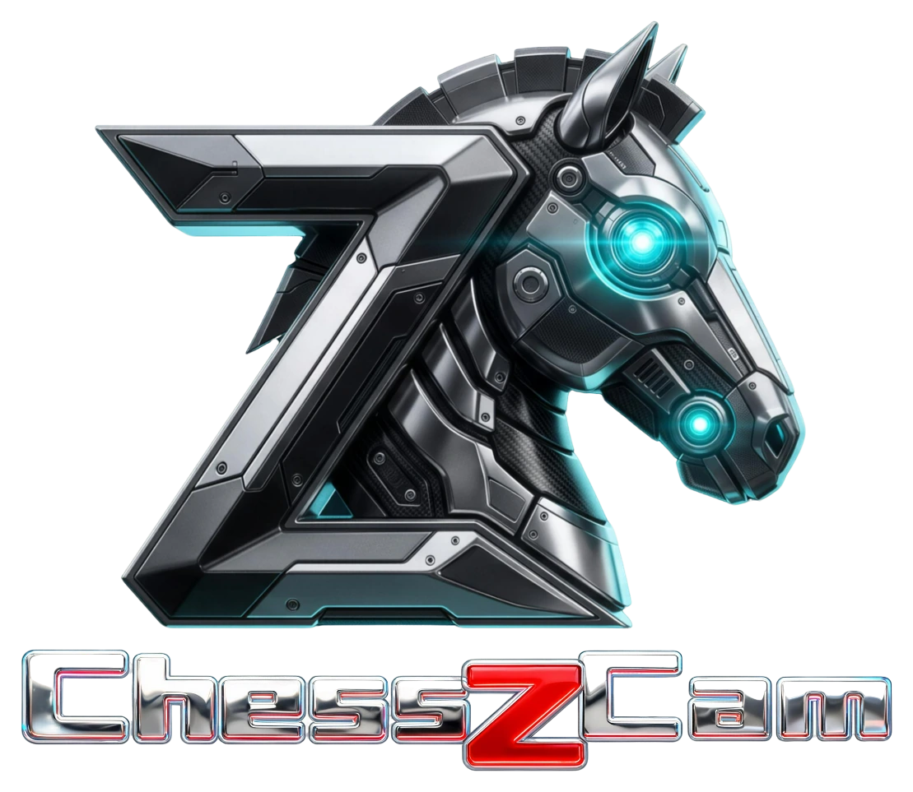
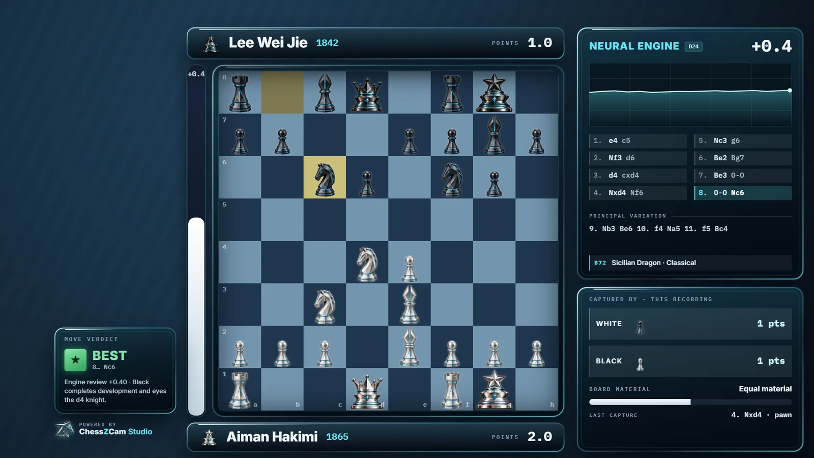
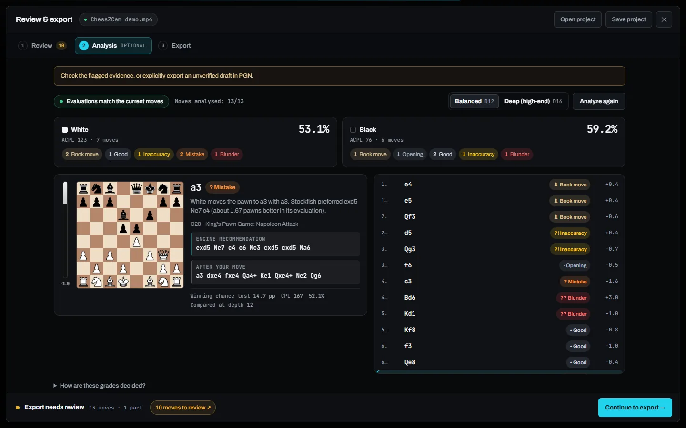
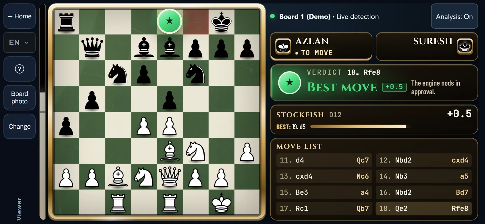

  

<h1 align="center">ChessZCam</h1>

  <b>Point a phone or a webcam at a real chess board. Get the moves.</b> 
  PGN, Stockfish analysis, an overlay video worth sharing, and a live board for vMix or OBS.

  <a href="https://zonchess.com/chesszcam-download.html"><b>Download</b></a> ·
  <a href="https://zonchess.com/chesszcam.html">Product page</a> ·
  <a href="https://zonchess.com/ms/chesszcam-download.html">Bahasa Melayu</a> ·
  <a href="https://github.com/mfamirs/chesszcam-downloads/releases">All releases</a>

ChessZCam follows an over-the-board game through a camera. Record a game and analyse it later, or let it follow the
board live. Every move is kept with its moment in the video, so you can check it, fix it and export it. It is made in
Malaysia by a chess parent, tested at real tournaments, and it is in its early trial now.

## Try it free for 14 days

- **No code, no payment, no account.** You choose when the trial starts; activate once online, then work offline.
- **One trial per PC in ChessZCam Studio, one per phone in the Android app.** During the Studio trial, ChessZCam Live
  is included: Studio can be the camera for your vMix or OBS overlay.
- **Your work stays yours.** After the trial you can still open, correct and export what you made, and Viewer stays free.

[**Download ChessZCam**](https://zonchess.com/chesszcam-download.html): one page for all three apps, with install
steps for Windows and Android.

## What you can do

| | |
|---|---|
| **Analyze a video** | Open an MP4 or WebM, lock the board and press Play & Detect. Uncertain moves are flagged for review instead of guessed. |
| **Detect a live game** | Camera straight to PGN while the game is played, without saving the video. |
| **Review and correct** | Each move beside its video frame and the board after it. Add a missed move by clicking or dragging, castling and promotion included. |
| **Analyse** | Optional Stockfish analysis on your own device: ten grades from Book move to Blunder, accuracy per player, opening names, comments in English and Malay. |
| **Export** | PGN, and overlay video up to 4K: MP4 with the overlay burned in, transparent WebM or a PNG sequence; landscape or portrait. |
| **Broadcast live** | The board, not the video, goes over your local network to ChessZCam Live, which drives a Browser Source in vMix or OBS. |
| **Share with Viewer phones** | Parents and coaches outside the playing hall follow the live board on their own Android phone, on the same Wi-Fi or hotspot. |

  
  

  
  

## Three apps

| App | For | Download |
|---|---|---|
| **ChessZCam Studio** | Windows 10/11 (64-bit). Analyze video, record from a webcam or capture card, Detect Live, review, analysis and export, Viewer hosting, and the camera for ChessZCam Live. | [Download page](https://zonchess.com/chesszcam-download.html) |
| **ChessZCam for Android** | Android 7 or newer, used with the phone held sideways. Record, analyze, Detect Live, Broadcast to the PC, Viewer, and Sync a PGN to a video. | [Download page](https://zonchess.com/chesszcam-download.html) |
| **ChessZCam Live vMix** | Windows 10/11 (64-bit), on the same PC as vMix or OBS. The operator console and the on-air overlay, fed by the phone app or Studio. | [Download page](https://zonchess.com/chesszcam-download.html) |

The apps tell you inside the app when a newer version is published, so you can keep up without checking this page.
When you use the phone with Live vMix, update both to the same release.

## Good to know

- **Early trial.** These are pre-release builds for evaluation, improved after every tournament test. Keep your own
  copy of important recordings and PGN.
- **Best-effort detection.** A steady stand, the whole board in view and good, even light make the biggest difference.
  When a move slips through, the correction tools help you fix it. See the
  [recording guide](https://zonchess.com/chess-recording-guide.html).
- **Standard chess, one camera, one board.** Live broadcast and Viewer work on the same local network, not over the
  internet.
- **Windows may warn the first time** ("Windows protected your PC"), because the apps are new: choose More info, then
  Run anyway. **The Android app is not on Google Play yet**: your browser downloads the APK and Android asks before
  installing it.
- **Private by design.** Moves are read on your own phone or PC. Recordings, PGN files and projects stay on your device;
  no account is needed. Starting a trial sends only what the [privacy policy](https://zonchess.com/privacy.html#chesszcam-activation)
  lists.
- **Fair play.** Viewer Mode shows engine analysis. It is for spectators outside the playing hall, never for players.

## After the trial

ChessZCam is paid software: one payment, no subscription, with updates included for two years. Sales are not open
yet. The packages, the free waitlist and its early-supporter offer are on the
[ChessZCam page](https://zonchess.com/chesszcam.html#commercial). Licence terms:
[zonchess.com/terms.html](https://zonchess.com/terms.html#chesszcam-licence).

## Feedback

Every report during the trial is read and helps decide the next fix. In the app, tap **Feedback** on the Home screen,
use the [feedback page](https://zonchess.com/feedback.html?product=ChessZCam), or email
[admin@zonchess.com](mailto:admin@zonchess.com).

## Releases and checksums

This repository holds the official release files only; the download page links here. Every
[release](https://github.com/mfamirs/chesszcam-downloads/releases) lists the SHA-256 of each file, so you can check
what you downloaded.

## Thank you

ChessZCam began with [ChessCam](https://github.com/Pbatch/CameraChessWeb), the open-source project by Peter
([Pbatch](https://github.com/Pbatch)). Thank you, Peter. The full list of projects and people ChessZCam is built on is
on the [credits page](https://zonchess.com/credits.html).

## Bahasa Melayu

ChessZCam membaca langkah catur daripada kamera telefon atau webcam: rekod langkah (PGN), analisis Stockfish, video
dengan overlay untuk dikongsi, dan papan langsung untuk vMix atau OBS. Cuba percuma selama 14 hari tanpa kod dan tanpa
bayaran: satu percubaan bagi setiap PC dalam ChessZCam Studio, dan satu bagi setiap telefon dalam aplikasi Android.
Muat turun dan panduan pemasangan: [zonchess.com/ms/chesszcam-download.html](https://zonchess.com/ms/chesszcam-download.html).

---

ChessZCam by [zonChess](https://zonchess.com) · Motivace Studio (MA0350336-V), Malaysia
